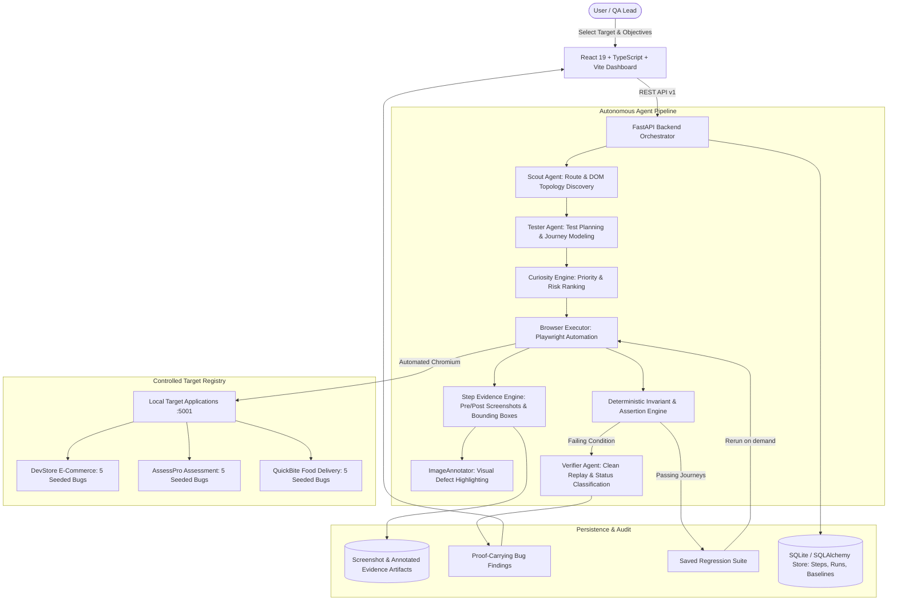

# Autonomous AI QA Engineer
### iMocha Track | Problem Statement IM-02

> **"Explore &rarr; Understand &rarr; Plan &rarr; Execute &rarr; Verify &rarr; Report &rarr; Learn"**

An autonomous, agentic software testing platform that explores web applications like an expert human QA engineer, decides what to test using an explainable **Curiosity Engine**, executes browser journeys through Playwright automation, captures **complete step-by-step screenshot evidence**, visually highlights defects with **automated defect bounding boxes**, verifies findings with deterministic replays, produces **proof-carrying bug reports**, and transforms successful journeys into **reusable regression suites**.

---

## The Two Primary Differentiators (USPs)

### USP 1 &mdash; Realistic, Multi-Page Test Target Applications
The platform supports three distinct, locally hosted demonstration targets with multi-route workflows, form validation, state persistence, and deterministic seeded defects:

1. **AssessPro (`http://127.0.0.1:5001/assesspro`):**
   - **Domain:** iMocha-style online talent assessment and candidate examination platform.
   - **Realistic Workflows:** Candidate sign-in, instructions acknowledgment, access code format validation, timed examination with real-time countdown timer, multi-question navigation with dynamic answered/unanswered question palette, answer persistence across page reloads, rapid double-click single-submission idempotency, score computation against answer key, and recruiter evaluation dashboard with access control.
   - **5 Seeded Defects:** `AP-BUG-01` (Question answers reset on reload), `AP-BUG-02` (Duplicate submission on rapid double-click), `AP-BUG-03` (Score calculation arithmetic desync), `AP-BUG-04` (Recruiter results access control non-disclosure), `AP-BUG-05` (Invalid access code boundary bypass).

2. **QuickBite (`http://127.0.0.1:5001/quickbite`):**
   - **Domain:** On-demand food-delivery platform with complex end-to-end ordering journeys.
   - **Realistic Workflows:** Restaurant discovery, cuisine filtering, restaurant menu browsing, dynamic cart item addition/removal, quantity increment with live subtotal/tax/delivery recalculation, delivery address form with required postal/phone boundary validation, local payment simulator with selectable outcomes (Success, Declined, Pending, Double-Click), order confirmation page, and live GPS order status tracking with order history.
   - **5 Seeded Defects:** `QB-BUG-01` (Cart quantity increment fails to recalculate subtotal), `QB-BUG-02` (Invalid postal code bypassed without validation), `QB-BUG-03` (Rapid double-click checkout creates duplicate orders), `QB-BUG-04` (Payment simulator declined transaction falsely confirmed), `QB-BUG-05` (Inconsistent order status between confirmation screen and persisted backend state).

3. **DevStore (`http://127.0.0.1:5001`):**
   - **Domain:** Full-stack e-commerce benchmark target.
   - **5 Seeded Defects:** `BUG-01` (Faulty email validation), `BUG-02` (Cart calculation arithmetic desync), `BUG-03` (Missing postal code validation), `BUG-04` (Non-idempotent duplicate order creation), `BUG-05` (Broken access control on `/account`).

---

### USP 2 &mdash; Complete Step-by-Step Screenshot Evidence & Visual Defect Highlighting
For every executed test journey, screenshot evidence is captured directly within the Playwright execution lifecycle:

- **Pre-Action & Post-Action Evidence:** Every meaningful step (navigation, form entry, button click, cart modification, question selection, payment submission) records `url_before`, `url_after`, execution duration, and captures `screenshot_before` and `screenshot_after`.
- **Automated Visual Defect Highlighting (`ImageAnnotator`):** When a step violates an invariant or encounters a defect, the system locates the failing element's bounding box and generates an annotated screenshot with a contrasting 3px alert border, a human-readable defect badge (e.g., *"Unexpected subtotal"* or *"Submission Failed"*), and a translucent red highlight overlay&mdash;**strictly preserving the original unmodified screenshot as source-of-truth**.
- **Interactive Step Timeline & Side-by-Side Modal:** The frontend provides a chronological step inspector with status badges, execution timings, assertion results, and a side-by-side comparison modal with full-resolution zoom.
- **Proof-Carrying Exported Reports:** HTML reports export complete step tables with thumbnails for Pre-Action, Post-Action, and Annotated Defect Highlights that link directly to full-resolution artifacts.
- **Auditable Quality Metrics:** Ground-truth benchmarks track **Screenshot Coverage (%)** and **Annotated Failure Coverage (%)** computed from actual stored step execution records.

---

## Architecture Overview



---

## Seeded Defect Catalog & Ground-Truth Registry

### AssessPro Seeded Defects (`/assesspro`)
| Bug ID | Location | Planted Defect | Expected Behavior | Actual Observed Defect |
| :--- | :--- | :--- | :--- | :--- |
| **AP-BUG-01** | `/assesspro/exam` | Answer Desync on Reload | Candidate answers must persist across page refresh | Selected answers are wiped upon page refresh |
| **AP-BUG-02** | `/assesspro/exam` | Double Submission Duplication | Rapid double-click on submit must be idempotent | Submits duplicate completed test attempts |
| **AP-BUG-03** | `/assesspro/result` | Score Calculation Arithmetic | Score must match sum of correct answers | Recalculated score underreports actual points |
| **AP-BUG-04** | `/assesspro/recruiter` | Evaluation Dashboard Non-Disclosure | Anonymous visits must be redirected to sign-in | Recruiter evaluation dashboard served to anonymous visits |
| **AP-BUG-05** | `/assesspro/instructions` | Access Code Boundary Validation | Enforces 6-character alphanumeric access code | Empty or malformed access code admitted into exam |

### QuickBite Seeded Defects (`/quickbite`)
| Bug ID | Location | Planted Defect | Expected Behavior | Actual Observed Defect |
| :--- | :--- | :--- | :--- | :--- |
| **QB-BUG-01** | `/quickbite/cart` | Cart Subtotal Arithmetic Desync | Incrementing item quantity updates subtotal | Subtotal remains stale despite quantity change |
| **QB-BUG-02** | `/quickbite/checkout/address` | Missing Postal Code Validation | Enforces valid 5-6 digit postal code | Empty or invalid postal code proceeds to payment |
| **QB-BUG-03** | `/quickbite/checkout/payment` | Duplicate Order Creation | Rapid double-click on pay button must be idempotent | Creates two identical orders with separate IDs |
| **QB-BUG-04** | `/quickbite/checkout/payment` | Declined Transaction Confirmation | Declined simulation must halt at payment page | Falsely shows confirmed order for declined card |
| **QB-BUG-05** | `/quickbite/order` | State Discrepancy on Confirmation | UI confirmation status must match database state | UI shows 'CONFIRMED' while database status is 'CANCELLED' |

### DevStore Seeded Defects (`/`)
| Bug ID | Location | Planted Defect | Expected Behavior | Actual Observed Defect |
| :--- | :--- | :--- | :--- | :--- |
| **BUG-01** | `/register` | Faulty Email Validation | Rejects emails without `@` or domain | Naively accepts invalid email format |
| **BUG-02** | `/cart` | Calculation Arithmetic Desync | Recalculates subtotal on quantity update | Subtotal display fails to update |
| **BUG-03** | `/checkout` | Missing Postal Code Validation | Enforces required Postal/ZIP code field | Allows empty postal code to place order |
| **BUG-04** | `/checkout` | Non-Idempotent Duplicate Order | Prevents rapid double-click submissions | Creates duplicate orders with separate IDs |
| **BUG-05** | `/account` | Broken Access Control | Redirects unauthenticated visits to login | Serves customer profile to anonymous visits |

---

## Resetting Demonstration State

Each target application provides deterministic reset endpoints that restore clean initial state without wiping QA test history:

- **Reset DevStore:** `POST http://127.0.0.1:5001/api/reset/devstore`
- **Reset AssessPro:** `POST http://127.0.0.1:5001/api/reset/assesspro`
- **Reset QuickBite:** `POST http://127.0.0.1:5001/api/reset/quickbite`
- **Reset Via QA Backend:** `POST http://127.0.0.1:8000/api/v1/targets/{target_id}/reset`
- **Reset from UI:** One-click *"Reset Target"* button on the **New Test Run** page.

---

## Quickstart & Installation

### Prerequisites
- Python 3.11+ (Python 3.12 recommended)
- Node.js v18+ and npm
- Playwright Chromium browser binaries

### 1. Backend Setup
```powershell
# Create and activate virtual environment
python -m venv backend\venv
.\backend\venv\Scripts\Activate.ps1

# Install requirements (including Pillow for visual highlighting)
pip install -r backend\requirements.txt

# Install Playwright browser binaries
playwright install chromium
```

### 2. Frontend Setup
```powershell
cd frontend
npm install
npm run build
cd ..
```

---

## Running the Application

### Option A: Unified One-Command Runner
Launches the Sample Store, Backend API, and Frontend concurrently:
```powershell
.\backend\venv\Scripts\python.exe scripts\run_demo.py
```

### Option B: Running Services Individually

1. **Terminal 1 &mdash; Controlled Sample Applications (Port 5001):**
   ```powershell
   .\backend\venv\Scripts\python.exe -m uvicorn sample_app.main:app --host 127.0.0.1 --port 5001
   ```
2. **Terminal 2 &mdash; FastAPI Autonomous QA Orchestrator (Port 8000):**
   ```powershell
   .\backend\venv\Scripts\python.exe -m uvicorn backend.app.main:app --host 127.0.0.1 --port 8000
   ```
3. **Terminal 3 &mdash; React Frontend (Port 5173):**
   ```powershell
   cd frontend
   npm run dev
   ```

Open your browser to:
- **Frontend Dashboard:** [http://localhost:5173](http://localhost:5173)
- **Backend Swagger API Docs:** [http://127.0.0.1:8000/docs](http://127.0.0.1:8000/docs)
- **Sample Store Target (DevStore):** [http://127.0.0.1:5001](http://127.0.0.1:5001)
- **Sample Assessment Target (AssessPro):** [http://127.0.0.1:5001/assesspro](http://127.0.0.1:5001/assesspro)
- **Sample Food Delivery Target (QuickBite):** [http://127.0.0.1:5001/quickbite](http://127.0.0.1:5001/quickbite)

---

## Running Automated Tests

Run the complete backend test suite covering evidence capture, image annotation, ground-truth benchmarks, security boundaries, and end-to-end autonomous QA:

```powershell
# Run core unit, evidence, and ground-truth benchmark tests (fast)
.\backend\venv\Scripts\python.exe -m pytest backend\tests\test_evidence_and_targets.py backend\tests\test_core.py backend\tests\test_benchmark_metrics.py backend\tests\test_assessment_and_baselines.py -v

# Run full end-to-end autonomous QA lifecycle (executes live Playwright browser)
.\backend\venv\Scripts\python.exe -m pytest backend\tests\test_e2e.py -v -s
```

---

## Judge Demonstration Sequence (5 Minutes)

1. **Select Target Application:**
   - Navigate to **New Test Run** (`http://localhost:5173/new-run`).
   - Notice the target selection cards: **DevStore**, **AssessPro (iMocha-Style Assessment)**, and **QuickBite (Food Delivery)**.
   - Click **QuickBite** or **AssessPro** to view pre-calibrated workflow objectives and seeded defect counts.
2. **Launch Autonomous Journey:**
   - Click **"Start Autonomous Test Run"**.
   - Watch the Scout Agent discover application routes and build the DOM topology.
   - Observe the Tester Agent generate multi-step journeys prioritized by the Curiosity Engine.
3. **Inspect Step-by-Step Screenshot Evidence (USP 2):**
   - Navigate to **Test Runs** or **Test Cases**.
   - Expand any test case to view the **Step-by-Step Execution Timeline**.
   - Notice that every executed action (navigation, click, form fill, cart modification) has thumbnail evidence.
   - Click **"View Evidence"** on any step to open the **Side-by-Side Step Evidence Viewer Modal** showing Pre-Action vs. Post-Action screenshots and step durations.
4. **Inspect Visual Defect Highlighting:**
   - Navigate to **Bug Reports** (`http://localhost:5173/bugs`) and open any defect finding.
   - Notice the **Annotated Visual Defect Highlight**: the exact failing element is surrounded by a pulsed alert border with a high-contrast label and translucent overlay.
   - Compare the annotated screenshot side-by-side with the unmodified original screenshot.
5. **Inspect Benchmark Console & Ground Truth:**
   - Navigate to **Benchmark Console** (`http://localhost:5173/benchmark`).
   - Switch between the tabs: **AssessPro**, **QuickBite**, and **DevStore**.
   - Inspect the quality metrics: Defect Recall (%), Precision (%), Reproducibility Rate (%), Journey Coverage (%), **Screenshot Coverage (%)**, and **Annotated Failure Coverage (%)**.
6. **Export Proof-Carrying Evidence Report:**
   - In any run or bug detail view, click **"Export HTML"**.
   - Open the exported HTML file in a browser to show a complete, standalone proof-carrying report with all step execution tables, thumbnails, and annotated failure displays.

---

## License

Developed for **iMocha Track | Problem Statement IM-02**.
All synthetic data and demonstration targets are for local verification only.
